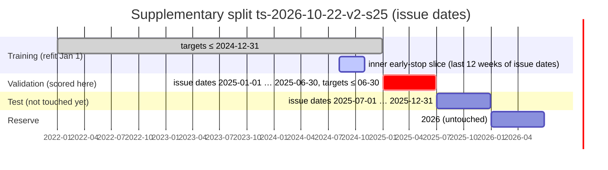
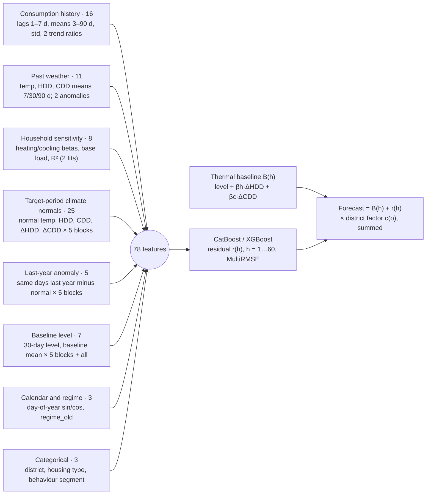
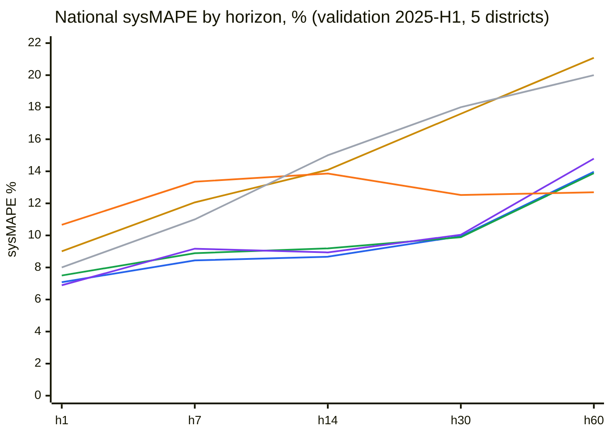
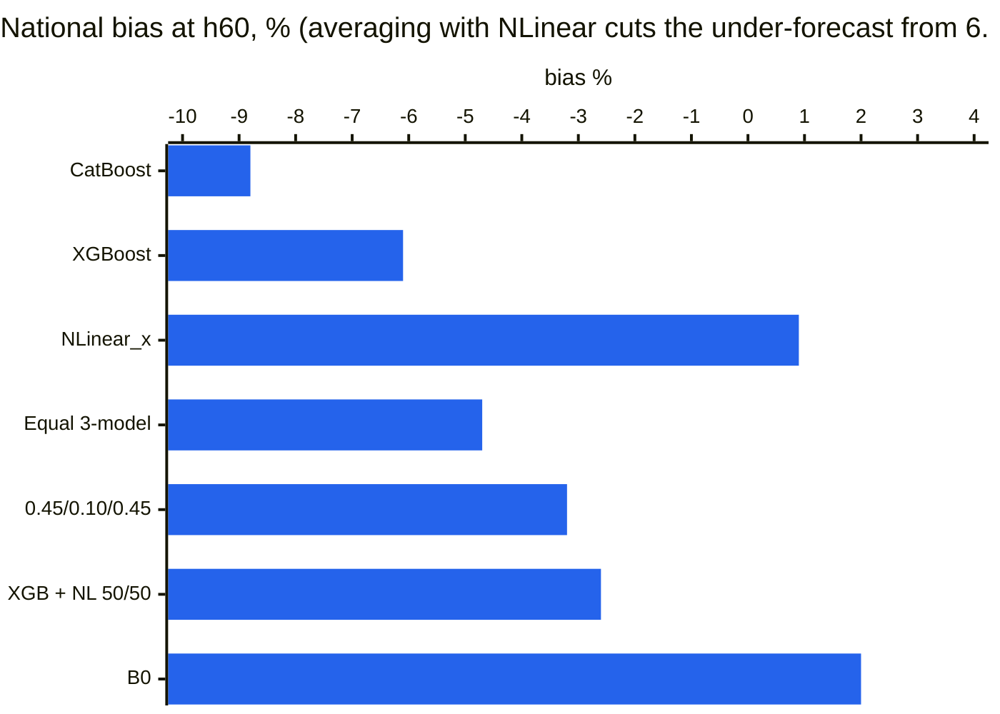

# No-weather model results: 2025 split

**2026-10-23 · Avazbek Isroilov** · runs at commit [`9a8a9aa`][c-runs], ensembles with [`scripts/ensemble.py`][ensemble] ([`c735e22`][c-ens])
· Docs version: [No-Weather Model Results: 2025 Split](https://claude.ai/artifact/QUbimfwjMjBjKCBHE7t4gV)

None of these models sees a weather forecast. XGBoost, CatBoost and NLinear_x each beat B0 by about 3 points of national sysMAPE (the XGBoost + NLinear 50/50 average beats it by 3.1). All three stay inside every ТЗ limit on the 2025-H1 validation. The run used a 5-district sample.

Code links point to commit `9a8a9aa`, the code that produced these numbers. Later commits changed some of the settings, so line numbers on `main` or on later commits may differ.

| Model | h1 | h7 | h14 | h30 | h60 | Within ТЗ limits |
|---|---|---|---|---|---|---|
| **Ensemble XGB + NLinear 50/50** | **6.75%** | 8.70% | 8.69% | 9.68% | 13.78% | 5 of 5 |
| Ensemble XGB / CatBoost / NLinear 0.45 / 0.10 / 0.45 | 6.81% | 8.68% | 8.73% | 9.65% | 13.66% | 5 of 5 |
| Ensemble XGB / CatBoost / NLinear, equal | 6.96% | 8.69% | 8.82% | **9.63%** | 13.51% | 5 of 5 |
| [XGBoost][m-xgb] | 7.08% | **8.44%** | **8.67%** | 9.95% | 13.97% | 5 of 5 |
| [CatBoost][m-cb] | 7.50% | 8.89% | 9.19% | 9.89% | 13.88% | 5 of 5 |
| [NLinear_x][m-nl] | 6.89% | 9.17% | 8.94% | 10.04% | 14.79% | 5 of 5 |
| [B0 (reference)][b0] | 10.66% | 13.35% | 13.86% | 12.52% | **12.69%** | 3 of 5 |
| [GAM][m-gam] | 9.01% | 12.06% | 14.09% | 17.59% | 21.08% | 2 of 5 |
| ТЗ limit | 8% | 11% | 15% | 18% | 20% | |

The table shows national sysMAPE per horizon; bold marks the best value in each column. The ТЗ limits formally apply to the national test, so this is an early read.

**How to reproduce** (entry point [`evaluate.py`][evaluate], arguments in [`harness/cli.py`][cli]):

```bash
python scripts/test_set/build_test_set.py --spec configs/test_set_2025.yaml --sample
python evaluate.py --model xgboost   --mode validate --sample --test-set configs/test_set_2025.yaml
python evaluate.py --model catboost  --mode validate --sample --test-set configs/test_set_2025.yaml
python evaluate.py --model nlinear_x --mode validate --sample --test-set configs/test_set_2025.yaml
python evaluate.py --model gam       --mode validate --sample --test-set configs/test_set_2025.yaml
python scripts/ensemble.py --runs <xgboost run> <nlinear_x run> --test-set configs/test_set_2025.yaml --name ens_xgb_nl
```

The first command builds the sample test set ([`build_test_set.py`][build-ts]).

## Dataset split

The split is defined in [`configs/test_set_2025.yaml`][spec-s25]. The refit dates are applied by [`refit_blocks`][refit-blocks], and the training window by [`train_window`][train-window].



| Rule | Value | Code |
|---|---|---|
| Forecast | Issued on day o for d = o + h, h = 1..60; inputs up to o − 1 | [`history_gap_days`][spec-s25] |
| Training at refit R | Target days ≤ R − 1 (last issue date R − 61); refits on 2025-01-01 and 2025-04-01 | [`train_window`][train-window] |
| Validation scored | 181 issue dates (2025-01-01 to 2025-06-30) with targets ≤ June 30: 180 days at h1, 121 at h60 | [`split_rows`][split-rows] |
| Score | Pooled over all issue dates: Σ\|P − A\| / ΣA on the national sum of 5 districts, over a common panel | [`score`][score], [`common_panel`][common-panel], [`_sm`][sm] |
| Leakage check | Substitution test passed for every model | [`substitution_test`][subst] |

## Training data

All models read the 222 districts of the enriched v1.4 dataset ([`core/enriched_io.py`][enriched-io]). Only `complete_observed` days are used as inputs ([`ENRICHED_LABELS`][labels]).

| Model | Customers used | Refit Jan 1: training rows | Refit Apr 1: training rows | Tuned on inner slice | Code |
|---|---|---|---|---|---|
| CatBoost / XGBoost (one shared fit) | 5 % of customers, then 20 % of windows | 397,201 windows (179,772 customers; 27,645 new-regime) | 523,683 windows (233,095 customers; 154,127 new-regime) | Trees found: CatBoost 2,996 / 2,966, XGBoost 2,431 / 757; capped at 150 | [`boost_harness.train`][bh-train], [`extract_windows_enriched`][extract], [`fit_and_evaluate`][fit] |
| NLinear_x | All ~7.7M customers | 36.8M windows | 48.4M windows | Penalty 10 / 3 | [`household_nlinear.district_worker`][nl-worker], [`solve_all`][nl-solve] |
| GAM (EBM) | 0.5 % of households, one row per horizon | 8.0M rows (cap) | 8.0M rows (cap) | 5,000 rounds max, 5 interactions | [`gam_features.district_rows`][gam-rows], [`models/gam/config.yaml`][gam-cfg] |
| B0 | District T2 series | No training | No training | — | [`b0_forecasts`][b0] |

**Window rules (household models):**
- History: 90 days ([`LOOKBACK`][lookback]) with at least 60 observed days, at least 20 of them in the last 30.
- Target: 60 days with at least 30 observed days ([`TRAIN_MIN_TARGET_DAYS: 30`][cb-cfg], overriding v8's 54; the reason is in [`regime_audit.py`][regime-audit]).
- Windows that touch Jan–Feb 2023 (the crisis) are dropped.

## Features

No model sees target-day weather: the target period uses climate normals only. The target period is split into blocks of days 1–7, 8–14, 15–30, 31–45 and 46–60. The boosters' 78 features are built by [`build_features`][build-features] with `forecast: none` ([`models/catboost/config.yaml`][cb-cfg]).



| Model | Inputs | Output | Code |
|---|---|---|---|
| GAM (EBM) | 15 inputs: temp, temp_dev, nrm_dev, log_level, r7_30, ly_ratio, r_last, ly_have, cv30, dow, housing, h, regime_old, plus 5 interactions (temp × level, temp × housing, temp × h, nrm_dev × h, r7_30 × h) | One target day per row | [`gam_features.rows`][gam-row] |
| NLinear_x | 90 days of a customer's history plus climate normals (exogenous) | 60 days, linear | [`design`][nl-design] |
| B0 | 28-day district level × last year's seasonal ratio | 60 days | [`b0_forecasts`][b0] |

Top GAM terms (refit Jan 1): log_level 0.119, temp 0.105, r7_30 0.081, temp_dev 0.078, ly_ratio 0.064.

## Results by horizon

The curves below are from the runs of 2026-10-23 (commit `9a8a9aa`). Each run also writes the full 1..60 horizon chart, drawn by [`plots.metrics_by_horizon`][plots].



**Blue** = XGBoost, **green** = CatBoost, **purple** = NLinear_x, **gold** = GAM, **orange** = B0, **grey** = ТЗ limit.

| Best at | h1 | h7 | h14 | h30 | h60 |
|---|---|---|---|---|---|
| Model | NLinear_x 6.89% | XGBoost 8.44% | XGBoost 8.67% | CatBoost 9.89% | B0 12.69% |
| Days scored | 180 | 174 | 167 | 151 | 121 |

## Gap to B0

The gap is the model's sysMAPE minus B0's, in percentage points, on the same days; negative means the model is better. B0 on those days: 10.66 / 13.35 / 13.86 / 12.52 / 12.69 % at h1 / h7 / h14 / h30 / h60.

| Model | h1 | h7 | h14 | h30 | h60 |
|---|---|---|---|---|---|
| XGB + NLinear 50/50 | −3.91 | −4.65 | −5.17 | −2.84 | +1.09 |
| XGBoost | −3.58 | −4.91 | −5.19 | −2.57 | +1.28 |
| CatBoost | −3.16 | −4.46 | −4.67 | −2.63 | +1.19 |
| NLinear_x | −3.77 | −4.18 | −4.92 | −2.48 | +2.10 |
| GAM | −1.65 | −1.29 | +0.23 | +5.07 | +8.39 |

## Bias by horizon

Bias is the national Σ(P − A) / ΣA, in %; below 0 means the forecast is too low. It is computed on the scaled forecasts (median c(o) 0.981) by [`_bias`][bias].

| Model | h1 | h7 | h14 | h30 | h60 |
|---|---|---|---|---|---|
| XGBoost | −2.2 | −2.6 | −2.1 | −4.2 | −6.1 |
| CatBoost | −2.4 | −3.9 | −4.0 | −6.4 | −8.8 |
| NLinear_x | −1.1 | −1.7 | −2.0 | −1.0 | +0.9 |
| GAM | −3.4 | −4.1 | −4.1 | −3.7 | −14.2 |
| B0 | +1.9 | +3.4 | +3.9 | +1.5 | +2.0 |

The boosters under-forecast more and more at longer horizons, and that is what costs them h60. NLinear drifts the other way, which suggests averaging XGBoost and NLinear.

## Network levels

These levels go from household up to substation, scored over the observed days of the forecast households. Household and transformer errors come from [`write_levels`][levels]; feeder and substation errors come from [`write_network`][network] and [`score_network`][score-network].

| XGBoost MAE at h7 | Household | Transformer | Feeder | Substation | District | National |
|---|---|---|---|---|---|---|
| kWh per node-day | 2.8 | 63.9 | 491.4 | 1,754 | 37,980 | 146,709 |

## Ensembles

Ensembles are built with [`scripts/ensemble.py`][ensemble]: a weighted mean of the saved district forecasts on the rows every member covers ([`combine`][ens-combine]), with no retraining. Members and B0 are scored on the same rows.

Averaging gives the best headline so far, 9.51–9.52 %. The three weightings differ by only 0.01 point, which is noise on 5 districts. Keep the simplest: XGBoost + NLinear_x 50/50.

| National sysMAPE, % | h1 | h7 | h14 | h30 | h60 | Headline |
|---|---|---|---|---|---|---|
| **XGB + NLinear 50/50** | **6.75** | 8.70 | 8.69 | 9.68 | 13.78 | 9.52 |
| XGB / CatBoost / NLinear 0.45 / 0.10 / 0.45 | 6.81 | 8.68 | 8.73 | 9.65 | 13.66 | **9.51** |
| XGB / CatBoost / NLinear, equal | 6.96 | 8.69 | 8.82 | **9.63** | 13.51 | 9.52 |
| XGBoost alone | 7.08 | **8.44** | **8.67** | 9.95 | 13.97 | 9.62 |
| B0 | 10.66 | 13.35 | 13.86 | 12.52 | **12.69** | 12.61 |



| h60 | CatBoost | XGBoost | NLinear_x | Equal 3-model | 0.45 / 0.10 / 0.45 | XGB + NL 50/50 | B0 |
|---|---|---|---|---|---|---|---|
| Bias, % | −8.8 | −6.1 | +0.9 | −4.7 | −3.2 | −2.6 | +2.0 |
| sysMAPE, % | 13.88 | 13.97 | 14.79 | 13.51 | 13.66 | 13.78 | **12.69** |

The remaining h60 gap to B0 is not bias but instability at long range. The next thing to try is B0 from about h45 onward, which is the guide's per-horizon choice.

## Caveats and next steps

| Caveat | Effect | Where |
|---|---|---|
| 2025 split only (supplementary) | Must be reported next to the guide's standard split (validation 2024), not instead of it | [`configs/test_set.yaml`][spec-std] |
| 5-district sample | Noisier than national; a national run is needed before drawing conclusions | `--sample` in [`harness/cli.py`][cli] |
| Boosters capped at 150 trees (best found: 757–2,996) | Under-trained, which mainly hurts h30–h60; fixed in [`559d422`][c-fix] (lr 0.15, up to 1,500 trees), and on the current branch GPU training with up to 4,000 trees | [`MAX_FINAL_ITERATIONS`][max-iter], [`_settings`][bh-settings] |
| `housing_type_id` is a today snapshot; training normals use other years (`loyo`) | Possible leakage, which the guide forbids (part 5); to be removed | [`NORMAL_MODE`][normal-mode] |

- [ ] Rerun the boosters with the higher tree caps (GPU)
- [ ] Remove the housing snapshot and use past-only normals, then rerun all four models
- [ ] Run the standard split (validation 2024) for the same models
- [x] Ensembles scored (best 9.51–9.52 %); next: B0 from about h45 in the ensemble
- [ ] National validation, then the test once for the chosen variant

## Scripts used

| Step | Script |
|---|---|
| Entry point | [`evaluate.py`][evaluate] → [`harness/cli.py`][cli] → [`harness/test_mode.py`][test-mode] |
| Test-set build | [`scripts/test_set/build_test_set.py`][build-ts], spec [`configs/test_set_2025.yaml`][spec-s25] |
| Scoring, B0 | [`harness/testset.py`][testset] |
| CatBoost / XGBoost | [`models/catboost`][m-cb], [`models/xgboost`][m-xgb] → [`core/boost_harness.py`][bh] → [`core/whole_pipeline_v8.py`][v8] |
| NLinear_x | [`models/nlinear_x`][m-nl] → [`core/household_nlinear.py`][nl] |
| GAM (EBM) | [`models/gam/model.py`][m-gam], [`models/gam/gam_features.py`][gam-feat] |
| Ensembles | [`scripts/ensemble.py`][ensemble] |
| Charts | [`harness/plots.py`][plots] |
| W&B comparison | [`scripts/compare_models.py`][compare] |
| Regime audit (why 30 target days, `regime_old`) | [`scripts/analysis/regime_audit.py`][regime-audit] |

[c-runs]: https://github.com/Avazbek2002/electricity/commit/9a8a9aa3f1363cece184c896f4768ae90039236b
[c-ens]: https://github.com/Avazbek2002/electricity/commit/c735e2277768c9e18e21e9a79142c6d420f10cb1
[c-fix]: https://github.com/Avazbek2002/electricity/commit/559d422c2e023de77efef72bc51594af0fa36d24
[ensemble]: https://github.com/Avazbek2002/electricity/blob/c735e2277768c9e18e21e9a79142c6d420f10cb1/scripts/ensemble.py
[ens-combine]: https://github.com/Avazbek2002/electricity/blob/c735e2277768c9e18e21e9a79142c6d420f10cb1/scripts/ensemble.py#L50
[evaluate]: https://github.com/Avazbek2002/electricity/blob/9a8a9aa3f1363cece184c896f4768ae90039236b/evaluate.py
[cli]: https://github.com/Avazbek2002/electricity/blob/9a8a9aa3f1363cece184c896f4768ae90039236b/harness/cli.py#L30
[test-mode]: https://github.com/Avazbek2002/electricity/blob/9a8a9aa3f1363cece184c896f4768ae90039236b/harness/test_mode.py
[subst]: https://github.com/Avazbek2002/electricity/blob/9a8a9aa3f1363cece184c896f4768ae90039236b/harness/test_mode.py#L268
[levels]: https://github.com/Avazbek2002/electricity/blob/9a8a9aa3f1363cece184c896f4768ae90039236b/harness/test_mode.py#L221
[network]: https://github.com/Avazbek2002/electricity/blob/9a8a9aa3f1363cece184c896f4768ae90039236b/harness/test_mode.py#L241
[build-ts]: https://github.com/Avazbek2002/electricity/blob/9a8a9aa3f1363cece184c896f4768ae90039236b/scripts/test_set/build_test_set.py
[spec-s25]: https://github.com/Avazbek2002/electricity/blob/9a8a9aa3f1363cece184c896f4768ae90039236b/configs/test_set_2025.yaml
[spec-std]: https://github.com/Avazbek2002/electricity/blob/9a8a9aa3f1363cece184c896f4768ae90039236b/configs/test_set.yaml
[testset]: https://github.com/Avazbek2002/electricity/blob/9a8a9aa3f1363cece184c896f4768ae90039236b/harness/testset.py
[refit-blocks]: https://github.com/Avazbek2002/electricity/blob/9a8a9aa3f1363cece184c896f4768ae90039236b/harness/testset.py#L72
[train-window]: https://github.com/Avazbek2002/electricity/blob/9a8a9aa3f1363cece184c896f4768ae90039236b/harness/testset.py#L85
[b0]: https://github.com/Avazbek2002/electricity/blob/9a8a9aa3f1363cece184c896f4768ae90039236b/harness/testset.py#L192
[split-rows]: https://github.com/Avazbek2002/electricity/blob/9a8a9aa3f1363cece184c896f4768ae90039236b/harness/testset.py#L268
[common-panel]: https://github.com/Avazbek2002/electricity/blob/9a8a9aa3f1363cece184c896f4768ae90039236b/harness/testset.py#L276
[sm]: https://github.com/Avazbek2002/electricity/blob/9a8a9aa3f1363cece184c896f4768ae90039236b/harness/testset.py#L312
[bias]: https://github.com/Avazbek2002/electricity/blob/9a8a9aa3f1363cece184c896f4768ae90039236b/harness/testset.py#L320
[score]: https://github.com/Avazbek2002/electricity/blob/9a8a9aa3f1363cece184c896f4768ae90039236b/harness/testset.py#L324
[score-network]: https://github.com/Avazbek2002/electricity/blob/9a8a9aa3f1363cece184c896f4768ae90039236b/harness/testset.py#L439
[plots]: https://github.com/Avazbek2002/electricity/blob/9a8a9aa3f1363cece184c896f4768ae90039236b/harness/plots.py#L69
[compare]: https://github.com/Avazbek2002/electricity/blob/9a8a9aa3f1363cece184c896f4768ae90039236b/scripts/compare_models.py
[regime-audit]: https://github.com/Avazbek2002/electricity/blob/9a8a9aa3f1363cece184c896f4768ae90039236b/scripts/analysis/regime_audit.py
[enriched-io]: https://github.com/Avazbek2002/electricity/blob/9a8a9aa3f1363cece184c896f4768ae90039236b/core/enriched_io.py
[m-cb]: https://github.com/Avazbek2002/electricity/tree/9a8a9aa3f1363cece184c896f4768ae90039236b/models/catboost
[m-xgb]: https://github.com/Avazbek2002/electricity/tree/9a8a9aa3f1363cece184c896f4768ae90039236b/models/xgboost
[m-nl]: https://github.com/Avazbek2002/electricity/tree/9a8a9aa3f1363cece184c896f4768ae90039236b/models/nlinear_x
[m-gam]: https://github.com/Avazbek2002/electricity/blob/9a8a9aa3f1363cece184c896f4768ae90039236b/models/gam/model.py
[cb-cfg]: https://github.com/Avazbek2002/electricity/blob/9a8a9aa3f1363cece184c896f4768ae90039236b/models/catboost/config.yaml
[gam-cfg]: https://github.com/Avazbek2002/electricity/blob/9a8a9aa3f1363cece184c896f4768ae90039236b/models/gam/config.yaml
[gam-feat]: https://github.com/Avazbek2002/electricity/blob/9a8a9aa3f1363cece184c896f4768ae90039236b/models/gam/gam_features.py
[gam-row]: https://github.com/Avazbek2002/electricity/blob/9a8a9aa3f1363cece184c896f4768ae90039236b/models/gam/gam_features.py#L95
[gam-rows]: https://github.com/Avazbek2002/electricity/blob/9a8a9aa3f1363cece184c896f4768ae90039236b/models/gam/gam_features.py#L119
[bh]: https://github.com/Avazbek2002/electricity/blob/9a8a9aa3f1363cece184c896f4768ae90039236b/core/boost_harness.py
[bh-settings]: https://github.com/Avazbek2002/electricity/blob/9a8a9aa3f1363cece184c896f4768ae90039236b/core/boost_harness.py#L64
[bh-train]: https://github.com/Avazbek2002/electricity/blob/9a8a9aa3f1363cece184c896f4768ae90039236b/core/boost_harness.py#L94
[nl]: https://github.com/Avazbek2002/electricity/blob/9a8a9aa3f1363cece184c896f4768ae90039236b/core/household_nlinear.py
[nl-design]: https://github.com/Avazbek2002/electricity/blob/9a8a9aa3f1363cece184c896f4768ae90039236b/core/household_nlinear.py#L119
[nl-worker]: https://github.com/Avazbek2002/electricity/blob/9a8a9aa3f1363cece184c896f4768ae90039236b/core/household_nlinear.py#L174
[nl-solve]: https://github.com/Avazbek2002/electricity/blob/9a8a9aa3f1363cece184c896f4768ae90039236b/core/household_nlinear.py#L354
[v8]: https://github.com/Avazbek2002/electricity/blob/9a8a9aa3f1363cece184c896f4768ae90039236b/core/whole_pipeline_v8.py
[labels]: https://github.com/Avazbek2002/electricity/blob/9a8a9aa3f1363cece184c896f4768ae90039236b/core/whole_pipeline_v8.py#L251
[lookback]: https://github.com/Avazbek2002/electricity/blob/9a8a9aa3f1363cece184c896f4768ae90039236b/core/whole_pipeline_v8.py#L288
[normal-mode]: https://github.com/Avazbek2002/electricity/blob/9a8a9aa3f1363cece184c896f4768ae90039236b/core/whole_pipeline_v8.py#L296
[max-iter]: https://github.com/Avazbek2002/electricity/blob/9a8a9aa3f1363cece184c896f4768ae90039236b/core/whole_pipeline_v8.py#L360
[extract]: https://github.com/Avazbek2002/electricity/blob/9a8a9aa3f1363cece184c896f4768ae90039236b/core/whole_pipeline_v8.py#L875
[build-features]: https://github.com/Avazbek2002/electricity/blob/9a8a9aa3f1363cece184c896f4768ae90039236b/core/whole_pipeline_v8.py#L1928
[fit]: https://github.com/Avazbek2002/electricity/blob/9a8a9aa3f1363cece184c896f4768ae90039236b/core/whole_pipeline_v8.py#L2327
