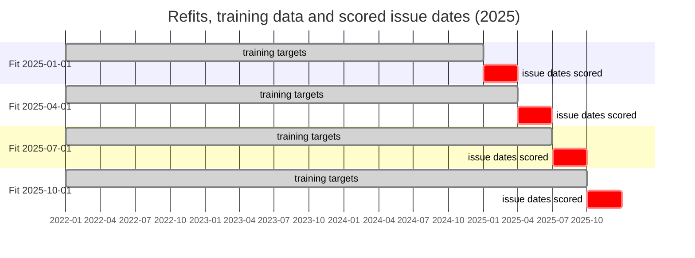
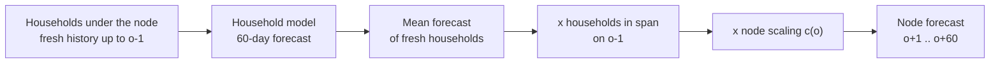
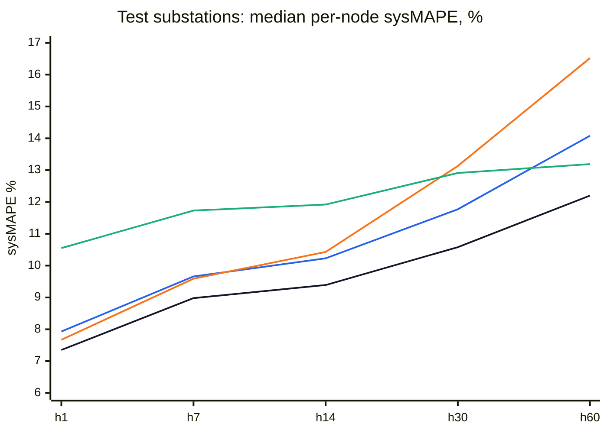
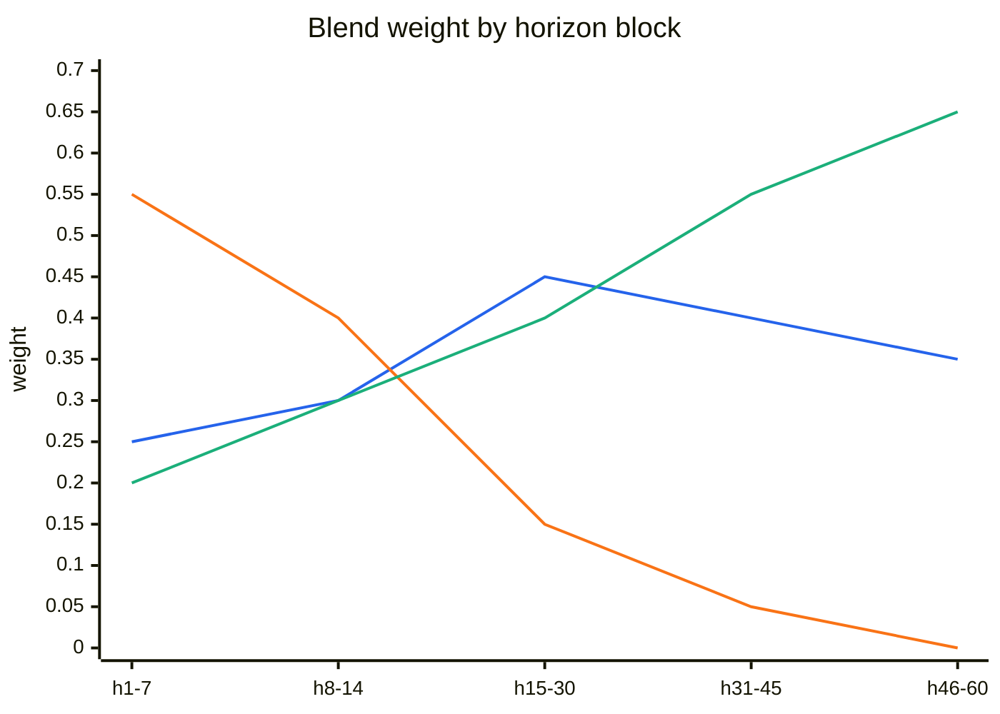

# Substation and feeder forecasts: 2025 dev and test

**2026-10-26 · Avazbek Isroilov** · runs at commit [`0a8e220`][c-run] on the B200 GPU pod · W&B:
[xgboost_all_s25](https://forge.coreweave.com/wandb/avazbekisroilov2002-ministry-of-digital-technologies/electricity-forecast/runs/v7mpp2jy) ·
[xgboost](https://forge.coreweave.com/wandb/avazbekisroilov2002-ministry-of-digital-technologies/electricity-forecast/runs/qfqpejid) ·
[nlinear_x](https://forge.coreweave.com/wandb/avazbekisroilov2002-ministry-of-digital-technologies/electricity-forecast/runs/ljh12shk)
· earlier reports: [no-weather models](no_weather_models_2025_split.md), [XGBoost with the weather forecast](xgboost_wx_2025_split.md)

The models forecast **households**; the forecasts are summed to **feeders and substations** and scored against the node
target (node T2). There are 60 selected substations: 20 for model choice (**dev**) and 40 scored once (**test**).

**Result.** The best forecast is a **per-horizon blend** of the 5 % XGBoost, NLinear-X and B0. Its weights are chosen
on dev and applied unchanged to test. On the test substations its median per-node sysMAPE (mean of h1/7/14/30/60) is
**9.70 % at substations** and **11.32 % at feeders**:

- 1.0–1.3 points better than the best single model;
- 2.3–2.4 points better than B0;
- bias within ±0.5 % at every control horizon.

| Median per-node sysMAPE, mean of h1/7/14/30/60 | Dev substation | Dev feeder | **Test substation** | **Test feeder** |
|---|---|---|---|---|
| **Blend: xgboost + nlinear_x + B0** (weights from dev) | 9.75%¹ | 10.74%¹ | **9.70%** | **11.32%** |
| Blend with xgboost_all_s25 as well | 9.69%¹ | 10.61%¹ | 9.62% | 11.26% |
| xgboost_all_s25 (all customers, 25 % of windows) | 10.43% | 11.43% | 10.77% | 12.38% |
| xgboost (5 % of customers) | 10.49% | 11.37% | 10.73% | 12.59% |
| nlinear_x | 11.88% | 12.78% | 11.47% | 13.28% |
| B0 (node) | 11.52% | 12.66% | 12.06% | 13.62% |

¹ Leave-one-quarter-out (§5.1): weights fitted on three quarters of dev, scored on the fourth. The weights fitted on all
of dev score 9.41 % / 10.46 % in-sample, which is optimistic by about 0.3 points.

**Main findings**

1. **The household → node approach works at node scale.** Both XGBoost versions beat B0 by 1.1–1.3 points on dev *and*
   on the 40 unseen test substations, in every size band.
2. **25× more training data changes nothing.** All customers with 25 % of windows (about 21M windows at the last
   refit) scores the same as the 5 % sample (about 260k windows): 10.43 % vs 10.49 % on dev, 10.77 % vs 10.73 % on
   test, inside the ±0.3-point run-to-run noise. Data volume is not the limit.
3. **No single model is best everywhere.** NLinear-X is best at h1–h7, XGBoost at h14–h30, and B0 at h60. The blend
   takes each where it is strongest, and part of their seasonal errors cancels.
4. **All household models share a seasonal bias.** They under-forecast April–June by 4–9 % and over-forecast
   November–December by 3–6 %. The blend halves it, but it is the main error left (§6).
5. **The aggregate-label idea and TiDE did not pay off** (§8). The old-regime data turned out to be mostly daily
   readings, and TiDE stayed 8–10 points behind XGBoost.

**How to reproduce** (entry point [`evaluate.py`][evaluate]; the node mode is [`harness/node_mode.py`][node-mode]):

```bash
python scripts/test_set/build_node_test_set.py --workers 12          # once: node targets for the 60 substations
MODE=test MODELS="xgboost nlinear_x" bash scripts/run_node_models.sh # fits, forecasts, dev + test scores, W&B
python scripts/node_blend.py --latest xgboost nlinear_x --out ~/work/eval/node_blend_dev_5pct
python scripts/node_blend.py --role test --latest xgboost nlinear_x \
    --apply ~/work/eval/node_blend_dev_5pct/weights.json --out ~/work/eval/node_blend_test_5pct
```

---

## 1. Test set and split

### 1.1 Which substations

Spec: [`configs/test_set_substations_2025.yaml`][spec] (version `ss-2026-10-25-v2`, frozen), built by
[`select_substations.py`][select].

| | Substations | Districts | Feeders scored (≥ 50 households) |
|---|---|---|---|
| **Dev** (model choice) | 20 | 16 | 109 |
| **Test** (scored once) | 40 (two per district: one large, one mid) | 20, in 14 regions | 157 |

Eligibility rules for a substation:
- at least 300 households;
- at least 85 % of households with a known network path;
- at most 10 % of households moved, and at most 10 % foreign;
- 2025 coverage of at least 70 %.

Feeders under 50 households are left out of the feeder scores, but their households still count in the substation.

### 1.2 Time and households

The split is **by time, not by node.** Each refit trains on all data before its refit date, from every district. The
selected substations are where the forecasts are scored; they are not held out of training.



- **Training households.** `xgboost` uses customer buckets 0–4 (about 5 % of customers, every district).
  `xgboost_all_s25` uses all customers.
- **Scored households.** Every household under the selected substations is forecast. About 5 % of them are also in the
  training sample; for those the model has seen only their history before each refit.
- **No leakage.** The substitution test randomises everything after a day T and checks that forecasts issued up to
  T+1 do not change. It passed for every run.

## 2. From households to a node



- **Node forecast:** `F_node(o, h)` = (households in span on o−1) × (mean forecast of the node's fresh households) ×
  c_node(o).
- **Scaling c_node(o):** node T2 per household over the last 28 days, divided by the fresh households' observed mean
  over the same days, clipped to 0.5–2. Without it, the forecast is written as `<model>_unscaled` and scored next to it.
- **Target:** node T2, the households in span × (kWh observed + estimated) / (n observed + n estimated). A node-day is
  flagged if:
  - fewer than 10 households are known;
  - coverage is below 70 %;
  - it falls at the right edge of the data;
  - it carries a crisis or data-interruption flag.
- **B0 (node):** m28 of T2 at o−1 × last year's seasonal ratio. The ratio is taken from **T3**, which includes allocated
  long-gap energy. Before 2024-08 almost every T2 node-day is flagged for low coverage, so a T2 ratio would fall back
  to 1.0 for all of 2025-H1 ([`nodeset.b0_forecasts`][b0]).
- **Metric:** per node and horizon, sysMAPE = Σ|P−A| / ΣA over the 2025 issue dates. The **median over nodes** is the
  headline; the pooled value (sum over all nodes) is shown in brackets in the run reports. Only node-days that are clean
  and forecast by every compared model are scored.

## 3. Models

| Model | Training data | Fit | Note |
|---|---|---|---|
| `xgboost` | buckets 0–4 (~5 % of customers), a 20 % window sample | GPU, ~10–20 min per refit | v8 features, thermal baseline + residual booster |
| `xgboost_all_s25` | all 7.7M customers, a 25 % window sample (9.9M → 20.9M windows) | GPU, 38–90 min per refit | XGBoost only ([`TRAIN_CATBOOST: false`][v8-cb]) |
| `nlinear_x` | household NLinear with exogenous inputs | CPU | |
| B0 | node T2 history only | none | |
| Blend | node forecasts of the above | grid search on dev | §5 |

The 100 % window version (`xgboost_all`) ran out of GPU memory on the 91.7 GB B200 at refit 2 (about 52M windows).
Given finding 2 it was not pursued.

**Tree counts (xgboost_all_s25):**

| Refit | Training windows | Validation windows | Trees |
|---|---|---|---|
| 2025-01-01 | 9.9M | 0.64M | 1,011 |
| 2025-04-01 | 13.1M | 3.07M | 377 |
| 2025-07-01 | 17.3M | 3.87M | 802 |
| 2025-10-01 | 20.9M | 3.27M | 1,218 |

The tree count still varies about 3× between refits, even with millions of validation windows. The likely cause is
that 93–95 % of fit windows are old-regime while validation is new-regime (§7).

## 4. Results

### 4.1 By horizon (test substations, median per-node sysMAPE)



**Black** = blend, **blue** = xgboost, **orange** = nlinear_x, **green** = B0.

| Test, substation (feeder) | h1 | h7 | h14 | h30 | h60 |
|---|---|---|---|---|---|
| **Blend** | **7.35** (**8.66**) | **8.98** (**10.66**) | **9.39** (**10.69**) | **10.58** (**12.38**) | **12.20** (**14.21**) |
| xgboost_all_s25 | 7.95 (9.20) | 10.00 (11.26) | 10.30 (11.57) | 11.30 (13.44) | 14.33 (16.43) |
| xgboost | 7.93 (9.39) | 9.66 (11.46) | 10.23 (11.51) | 11.77 (13.76) | 14.08 (16.84) |
| nlinear_x | 7.67 (8.73) | 9.59 (11.17) | 10.43 (12.15) | 13.13 (15.15) | 16.52 (19.22) |
| B0 | 10.55 (11.88) | 11.73 (13.21) | 11.92 (13.58) | 12.91 (14.11) | 13.19 (15.33) |

**Share of test substations better than B0:**

| | h1 | h7 | h14 | h30 | h60 |
|---|---|---|---|---|---|
| Blend | 100% | 100% | 98% | 95% | 78% |
| xgboost | 98% | 88% | 88% | 72% | 42% |

Single models lose to B0 at h60. The blend is the only forecast that beats B0 on most nodes at every horizon.

### 4.2 Bias (pooled, test substations)

| | h1 | h7 | h14 | h30 | h60 |
|---|---|---|---|---|---|
| Blend | −0.3% | −0.3% | +0.5% | −0.0% | +0.1% |
| xgboost | −1.1% | −1.4% | +0.1% | −0.7% | +1.4% |
| xgboost_all_s25 | −0.2% | +1.0% | +0.5% | −0.8% | +3.1% |
| nlinear_x | −0.3% | −0.3% | +0.4% | +0.6% | +3.6% |

### 4.3 By node size (test, mean over the control horizons)

| | n | Blend | xgboost_all_s25 | xgboost | nlinear_x | B0 |
|---|---|---|---|---|---|---|
| Substation, large | 20 | **8.92%** | 9.64% | 10.06% | 11.24% | 11.06% |
| Substation, mid | 20 | **10.23%** | 11.50% | 11.47% | 11.76% | 12.43% |
| Feeder 400+ households | 73 | **9.89%** | 11.04% | 11.07% | 12.21% | 12.25% |
| Feeder 150–399 | 49 | **11.65%** | 12.77% | 12.92% | 13.62% | 13.69% |
| Feeder 50–149 | 35 | **13.38%** | 15.15% | 15.17% | 15.61% | 16.39% |

The more households a node has, the smaller its error, as household noise averages out. The all-customer XGBoost gains
only on the 20 large substations (9.64 % vs 10.06 %).

### 4.4 Dev and test agree

| xgboost_all_s25 vs B0 | Dev substation | Test substation | Dev feeder | Test feeder |
|---|---|---|---|---|
| Model | 10.43% | 10.77% | 11.43% | 12.38% |
| B0 | 11.52% | 12.06% | 12.66% | 13.62% |
| Gap | −1.09 | −1.29 | −1.23 | −1.24 |

Test nodes are a little harder for every forecast, B0 included, but the model's lead holds. Choosing on dev did not
overfit.

## 5. The blend

### 5.1 Method ([`scripts/node_blend.py`][blend])

- **Weights:** for each horizon block (1–7, 8–14, 15–30, 31–45, 46–60), a convex combination of the components on a
  0.05 grid.
- **Objective:** minimise the mean per-node error. Each node-day is weighted by 1 / its node's actual total, so large
  substations do not dominate. Substations and feeders share one set of weights.
- **Fair dev score:** leave-one-quarter-out. Weights are fitted on three quarters of the 2025 issue dates and scored on
  the fourth, rotated over all four.
- **Test:** the weights fitted on all of dev are applied unchanged (`--apply`). Nothing is fitted on test.

### 5.2 Weights (5 % XGBoost blend, all of dev)



**Blue** = xgboost, **orange** = nlinear_x, **green** = B0.

The weights are stable across the four held-out quarters. NLinear-X dominates the first week, B0 takes over from about
day 30, and XGBoost keeps 25–45 % throughout.

### 5.3 The 5 % model is enough

| Blend | Dev (cross-validated) substation / feeder | Test substation / feeder |
|---|---|---|
| xgboost (5 %) + nlinear_x + B0 | 9.75% / 10.74% | 9.70% / 11.32% |
| + xgboost_all_s25 | 9.69% / 10.61% | 9.62% / 11.26% |

The two blends differ by under 0.15 points. The 5 % blend avoids the 4-hour all-customer fits, so it is the
recommended production setup.

## 6. Seasonal bias: the main error left

**Pooled bias by issue month, test substations (mean over the control horizons):**

| Month | Blend | xgboost | nlinear_x | B0 |
|---|---|---|---|---|
| Jan | +4.0% | +0.7% | +1.3% | +9.0% |
| Feb | +1.5% | +0.9% | +3.8% | +5.4% |
| Mar | +1.1% | +2.4% | +9.2% | −2.8% |
| Apr | −2.9% | −3.7% | +3.3% | −9.4% |
| May | −4.9% | −7.2% | −6.0% | −5.1% |
| Jun | −6.1% | −8.5% | −9.5% | −0.4% |
| Jul | +0.3% | −1.5% | −3.1% | +4.0% |
| Aug | +1.5% | +1.3% | +4.9% | +1.1% |
| Sep | +5.7% | +0.5% | +11.4% | +6.1% |
| Oct | +2.0% | +3.8% | −0.9% | +4.9% |
| Nov | −0.5% | +3.0% | +1.8% | −4.6% |
| Dec | +0.8% | +3.4% | +1.2% | −0.8% |

The same pattern appears on dev. Every household model under-forecasts the late-spring / early-summer rise, and the
blend still carries −5 to −6 % in May–June and +4–6 % in January and September.

Two likely causes:
- The standard run has no target-day weather (normals only), so a hotter-than-normal 2025 summer is invisible.
- Old-regime winters, which read 7–17 % higher, dominate training (§7).

The weather-forecast run removed 2–3 points at h1–h7 nationally ([xgboost_wx report](xgboost_wx_2025_split.md)).

## 7. Old regime vs new regime

Before 2024-08-01, meters were read in whole kWh with many 2–3-day estimated intervals. From 2024-08 there are daily
decimal readings. In the all-customer fits:

| Refit | Old-regime windows in fit | New-regime windows |
|---|---|---|
| 2025-01-01 | 35.7M (100 % of fit) | validation only (2.6M) |
| 2025-04-01 | 37.0M | 0.3M (+12.3M validation) |

Early stopping therefore picks the tree count on a different regime from the one the trees are fitted on. That is the
probable cause of the 377–1,218 tree swings. It also explains why the 2025-01 refit (validation only Aug–Nov 2024) is
the weak spot of the all-customer model in January–February: +2.4 to +6.2 % bias, against +0.1 to +0.9 % for the 5 %
model.

## 8. What did not work

### 8.1 TiDE with aggregate (reading-interval) labels

**Code:** [`core/tide.py`][tide], [`core/tide_data.py`][tide-data], `models/tide_agg`, `models/tide_daily`.

**Idea:** train a household TiDE whose loss includes the **sum over each reading interval**, so pre-2024 interval data
can be used without inventing a daily shape.

| Dev, median node sysMAPE | Substation | Feeder |
|---|---|---|
| tide_agg (run 1, Huber loss) | 18.29% | 18.87% |
| tide_daily (run 1) | 18.00% | 18.69% |
| tide_agg (run 2: MSE, year-ago inputs, daily new-regime windows) | 20.67% | 21.61% |
| xgboost | 10.49% | 11.37% |

- **Interval labels never helped.** tide_agg and tide_daily were within noise in both runs. The fit logs showed why:
  the old regime is mostly *daily* readings (about 70M daily target rows against about 14M interval rows per epoch,
  most of them 2–3-day estimated runs). There was little interval information to unlock.
- **TiDE itself fell well short.** In run 2 it over-forecast January–March by about 30 %. The likely cause is that
  "no interval inputs" acted as a regime flag confounded with season.

TiDE was dropped.

### 8.2 More data

As above, the 25 % all-customer fit scored the same as the 5 % sample (finding 2).

## 9. Next steps

1. **Seasonal bias correction** of the blend, fitted on dev only (per month or per season and horizon block). This
   targets the main remaining error (§6).
2. **Weather forecast at node level:** `xgboost_wx` in the node harness. It should cut the h1–h14 error and part of the
   summer bias.
3. **Stable early stopping:** a lower learning rate, a minimum tree count, and validation drawn from the same regime as
   the fit (§7).
4. **Production:** wrap the blend (xgboost + nlinear_x + B0, weights in `weights.json`) as a model, so window charts and
   W&B curves come out for it like for the single models.

## Appendix: run folders and charts

| Run | Folder (pod) |
|---|---|
| xgboost_all_s25, dev + test | `~/work/eval/runs/20261026-152100_xgboost_all_s25_nodes-dev-test/` |
| xgboost, dev + test | `~/work/eval/runs/20261026-153112_xgboost_nodes-dev-test/` |
| nlinear_x, dev + test | `~/work/eval/runs/20261026-154106_nlinear_x_nodes-dev-test/` |
| Blend (5 %), dev / test | `~/work/eval/node_blend_dev_5pct/`, `~/work/eval/node_blend_test_5pct/` |

Each model run has, for dev and test:
- `scores/<role>/report.txt`, `summary.csv`, `by_month.csv`, `by_band.csv` and `per_node.csv`;
- 12 substation window charts in `scores/<role>/windows/*.png`: actual node T2 against the model, the unscaled model
  and B0 over the 60 days, with the district's daily max / min temperature. Interactive versions are in W&B under
  `windows/<role>/...`.

[c-run]: https://github.com/Avazbek2002/electricity/tree/0a8e220
[evaluate]: https://github.com/Avazbek2002/electricity/blob/0a8e220/evaluate.py
[node-mode]: https://github.com/Avazbek2002/electricity/blob/0a8e220/harness/node_mode.py
[spec]: https://github.com/Avazbek2002/electricity/blob/0a8e220/configs/test_set_substations_2025.yaml
[select]: https://github.com/Avazbek2002/electricity/blob/0a8e220/scripts/test_set/select_substations.py
[b0]: https://github.com/Avazbek2002/electricity/blob/0a8e220/harness/nodeset.py
[blend]: https://github.com/Avazbek2002/electricity/blob/0a8e220/scripts/node_blend.py
[v8-cb]: https://github.com/Avazbek2002/electricity/blob/0a8e220/core/whole_pipeline_v8.py
[tide]: https://github.com/Avazbek2002/electricity/blob/0a8e220/core/tide.py
[tide-data]: https://github.com/Avazbek2002/electricity/blob/0a8e220/core/tide_data.py
