# XGBoost with the real weather forecast (`xgboost_wx`): 2025 split

**2026-10-23 · Avazbek Isroilov** · run at commit [`32ce082`][c-run] on the B200 GPU pod · [W&B run `ca9iwhj7`](https://forge.coreweave.com/wandb/avazbekisroilov2002-ministry-of-digital-technologies/electricity-forecast/runs/ca9iwhj7)
· companion report: [no-weather models on the same split](no_weather_models_2025_split.md)

This is the same v8 XGBoost as in the no-weather report: the same thermal baseline plus a residual booster. The one difference is the weather for target days h1–h14. Here it comes from the **real AIFS forecast issued on the issue date**, at training and at predict time, instead of climate normals.

**Result:** on the 24 validation issue dates that have a forecast, national sysMAPE is 5.98 / 7.21 / 8.12 % at h1 / h7 / h14. That is 4.2–4.5 points better than B0 and well inside the ТЗ limits. h30 is the weak spot: 12.64 %, 1 point worse than B0.

**Same-dates check (§4.4, rerun at `2e187b1`):** against the same XGBoost without weather, the forecast cuts error by 2.1 points at h1 and 3.1 points at h7. From h14 on there is no weather effect; the h30–h60 differences come from unstable early stopping.

Code links point to commit `32ce082`. Later commits changed the tree caps (`e9c5504`), so line numbers on later commits may differ.

| National sysMAPE (bias) | h1 | h7 | h14 | h30 | h60 |
|---|---|---|---|---|---|
| **xgboost_wx** | **5.98%** (−1.5) | 7.21% (−3.0) | 8.12% (−0.4) | 12.64% (−5.6) | 11.55% (−7.4) |
| xgboost_wx, unscaled (no c(o)) | 5.93% (+0.9) | **6.85%** (−0.8) | **8.05%** (+1.7) | 12.55% (−3.7) | **10.96%** (−5.6) |
| B0, same days | 10.52% (+2.6) | 11.57% (+2.5) | 12.33% (+4.2) | **11.68%** (−1.0) | 12.90% (+0.3) |
| ТЗ limit | 8% | 11% | 15% | 18% | 20% |
| Days scored | 24 | 23 | 22 | 20 | 17 |

**How to reproduce** (entry point [`evaluate.py`][evaluate], arguments in [`harness/cli.py`][cli]):

```bash
python core/reforecast.py --inspect                       # once: check columns, variables and points of the archive
python scripts/test_set/build_test_set.py --spec configs/test_set_2025.yaml --sample
python evaluate.py --model xgboost_wx --mode validate --sample --weather aifs --test-set configs/test_set_2025.yaml
# the same 24 dates without weather (the fair comparison):
python evaluate.py --model xgboost --mode validate --sample --issue-dates reforecast --test-set configs/test_set_2025.yaml
```

---

## 1. Data split

### 1.1 Calendar

The split is the supplementary `ts-2026-10-22-v2-s25` ([`configs/test_set_2025.yaml`][spec-s25]). The forecast archive has two sets: `wx-val2024` (2024 inits) and `wx-test2025` (2025 inits). The 2026 reserve set is never read ([`wx_config`][rf-wxconfig]).

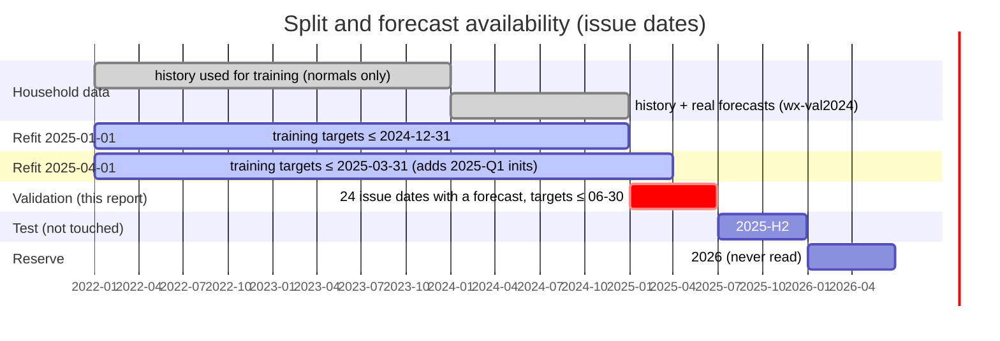

### 1.2 Training windows per refit

The forecasts exist on only 4 init dates a month (the 1st, 9th, 17th and 25th). With `origins: reforecast+stride` ([`xgboost_wx/config.yaml`][cfg]), each refit trains on two kinds of window:

- windows whose issue date is an init date, which have the real forecast;
- v8's usual staggered windows, which have no forecast. On these the forecast features are NaN and the target period uses normals. They keep 2022–2023 in training.

The windows are built by [`fixed_origins`][wx-fixed] and [`origin_grid`][wx-grid] in `core/wx_windows.py`. A refit is refused if fewer than 20,000 windows have a forecast ([`train`][bw-train]).

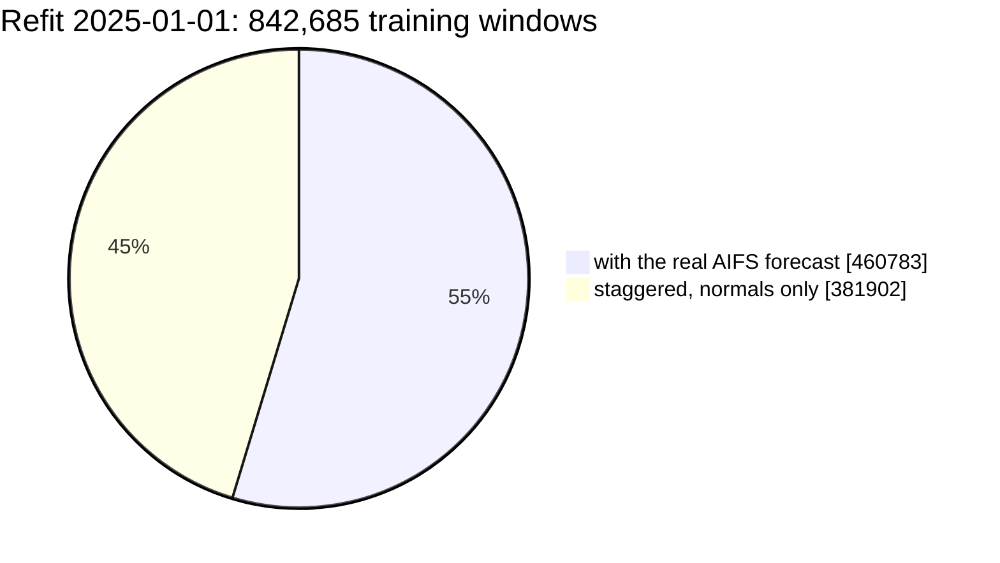

| Refit | Training windows | With a real forecast | Trees (XGBoost) |
|---|---|---|---|
| 2025-01-01 | 842,685 | 460,783 (55 %) | early-stopped at 1,129 |
| 2025-04-01 | not in this log | 925,354 | not in this log |

The other training rules are the same as in the no-weather run:
- a refit at R sees only target days ≤ R − 1;
- 5 % of customers, then 20 % of their windows;
- windows need ≥ 30 of 60 target days observed;
- early stopping is tuned on the last 12 weeks of training issue dates.

### 1.3 Validation and test

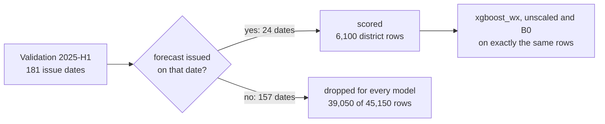

Only issue dates with a forecast are scored ([`_reforecast_blocks`][tm-blocks]). Targets must stay ≤ 2025-06-30, so the count falls with the horizon: 24 dates at h1, 17 at h60. The test half (2025-H2) was not run: this was a validation run.

---

## 2. Features

### 2.1 How a forecast enters one window

The archive is 6-hourly, in UTC, for each district. [`to_daily`][rf-daily] turns it into Tashkent-local days using the 00/06/12/18 UTC steps of each day:
- `t_fc` is the daily mean;
- `t_fc_min` and `t_fc_max` are the daily min and max;
- °C conversion from Kelvin is automatic.

[`to_window_convention`][rf-conv] then maps issue o and lead k to v8's window origin o − 1. Window lead 1 (day o) stays empty, exactly as at predict time ([`grid_at_last_day`][w-last]).

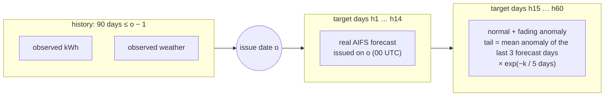

After the forecast ends, the blend in [`blend_forecast`][v8-blend] fades the anomaly away: it has about 5 % of its size left by h30. The blended temperature feeds the thermal baseline B(h) and the target-period block features, and the forecast also adds its own 34 features.

### 2.2 Feature set: 78 + 34 = 112

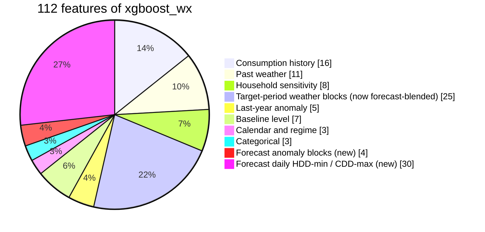

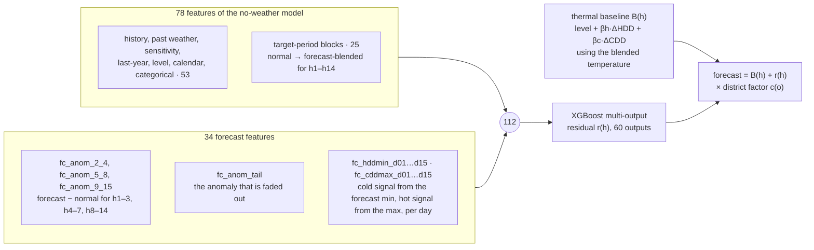

| New feature | Count | What it is | Code |
|---|---|---|---|
| `fc_anom_2_4`, `fc_anom_5_8`, `fc_anom_9_15` | 3 | Mean of forecast minus normal over h1–3, h4–7 and h8–14 | [`build_features`][v8-anom], blocks from [`v8_forecast_settings`][bw-fs] |
| `fc_anom_tail` | 1 | Mean anomaly of the last 3 forecast days; this is the part that fades | [`blend_forecast`][v8-blend] |
| `fc_hddmin_d01…d15` | 15 | max(base − forecast Tmin, 0) per day; d01 (day o) is always empty | [`build_features`][v8-mm], [`degree_days_minmax`][v8-ddmm] |
| `fc_cddmax_d01…d15` | 15 | max(forecast Tmax − base, 0) per day; d01 is always empty | [`build_features`][v8-mm] |

On the staggered windows without a forecast, all 34 are NaN and the blocks use normals. XGBoost learns both cases in one model.

### 2.3 Training and serving use the same inputs

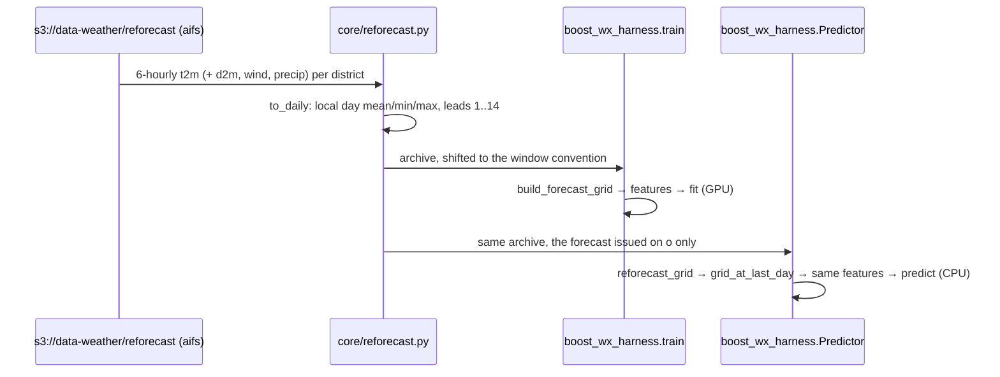

Train/serve equality is covered by [`tests/test_reforecast.py`][tests]. The substitution (leakage) test passed: for district 03203 with T = 2025-02-09, forecasts issued ≤ T + 1 changed by 0 ([`substitution_test`][tm-subst]).

---

## 3. Evaluation method

| Step | Rule | Code |
|---|---|---|
| Target | District T2 per day (observed + estimated kWh, scaled to all rows); flagged days are not scored | [`configs/test_set_2025.yaml`][spec-s25] |
| Rows | Common panel: the rows every compared model has; B0 is always on the same rows | [`common_panel`][common-panel] |
| National | Sum of districts for each (o, h), kept when ≥ 98 % of the run's districts are present | [`score`][score] |
| sysMAPE | Σ\|P − A\| / ΣA, pooled over all scored issue dates, per horizon | [`_sm`][sm] |
| Bias | Σ(P − A) / ΣA; below 0 = too low | [`_bias`][bias] |
| Reference | B0 = 28-day level × last year's seasonal ratio | [`b0_forecasts`][b0] |
| Scaled vs unscaled | Scaled = model × district factor c(o); unscaled = raw bottom-up sum | [`harness/test_mode.py`][test-mode] |
| Network levels | Household → substation, bottom-up over the observed days of the forecast households (supplementary) | [`write_levels`][levels], [`write_network`][network] |

---

## 4. Results

### 4.1 sysMAPE by horizon

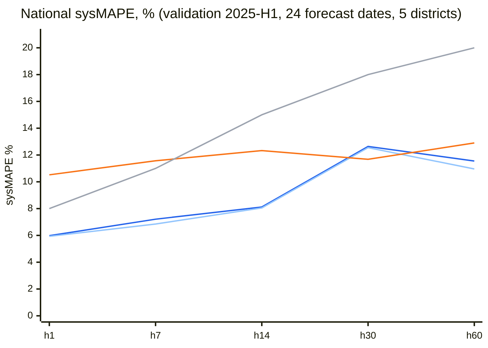

**Blue** = xgboost_wx, **light blue** = unscaled, **orange** = B0, **grey** = ТЗ limit. Each run also writes the full 1..60 horizon chart ([`plots.metrics_by_horizon`][plots]).

### 4.2 Gap to B0 on the same days

The gap is in percentage points; below 0 means better than B0.

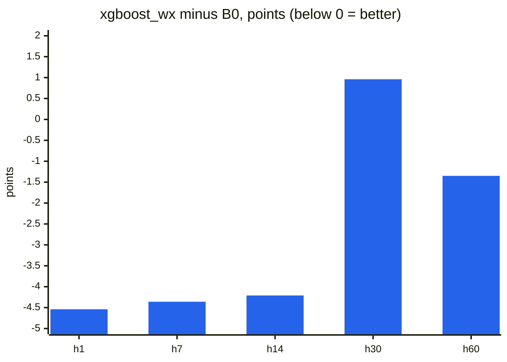

| Points vs B0 | h1 | h7 | h14 | h30 | h60 |
|---|---|---|---|---|---|
| xgboost_wx | −4.54 | −4.36 | −4.21 | +0.96 | −1.35 |
| xgboost_wx unscaled | −4.59 | −4.72 | −4.28 | +0.87 | −1.94 |

### 4.3 Bias

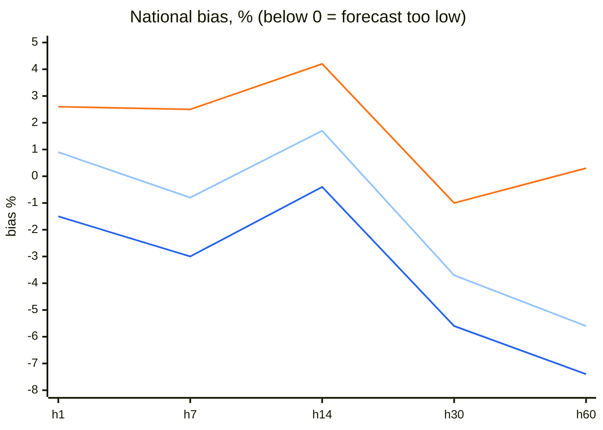

**Blue** = xgboost_wx, **light blue** = unscaled, **orange** = B0.

The c(o) scaling pushes the bias down by about 2 points at every horizon, so the unscaled forecast is better everywhere. The growing under-forecast after h14 is the same pattern the no-weather boosters show.

### 4.4 Same dates, with and without the forecast

This rerun used the same commit (`2e187b1`), the same 24 issue dates and the same B0 rows for both models. The no-weather model was scored with `--issue-dates reforecast`. **The forecast cuts national error by 2.1 points at h1 and 3.1 points at h7. From h14 on it adds nothing.**

```mermaid
%%{init: {"themeVariables": {"xyChart": {"plotColorPalette": "#2563eb, #9ca3af, #f97316"}}}}%%
xychart-beta
    title "Same 24 dates: national sysMAPE, % (commit 2e187b1, 5 districts)"
    x-axis [h1, h7, h14, h30, h60]
    y-axis "sysMAPE %" 0 --> 16
    bar [5.59, 7.79, 9.27, 12.24, 14.03]
    bar [7.70, 10.87, 9.25, 12.08, 12.69]
    line [10.52, 11.57, 12.33, 11.68, 12.90]
```

**Blue bars** = xgboost_wx (AIFS), **grey bars** = xgboost without weather, **orange line** = B0 on the same days.

| National sysMAPE (bias), % | h1 | h7 | h14 | h30 | h60 | Mean |
|---|---|---|---|---|---|---|
| **xgboost_wx (AIFS)** | **5.59** (−1.6) | **7.79** (−3.0) | 9.27 (+0.7) | 12.24 (−5.4) | 14.03 (−5.7) | **9.78** |
| xgboost, no weather | 7.70 (−2.0) | 10.87 (−5.3) | 9.25 (−0.2) | 12.08 (−6.2) | **12.69** (−6.4) | 10.52 |
| **Weather effect, points** | **−2.11** | **−3.08** | +0.02 | +0.16 | +1.34 | −0.74 |
| Weather effect, unscaled | −2.55 | −2.56 | +0.01 | +0.42 | +1.93 | |
| B0, same days | 10.52 | 11.57 | 12.33 | **11.68** | 12.90 | 11.80 |

| District-level sysMAPE, % | h1 | h7 | h14 | h30 | h60 |
|---|---|---|---|---|---|
| xgboost_wx | **8.07** | **10.66** | **12.05** | 16.24 | **18.87** |
| xgboost, no weather | 9.32 | 13.53 | 12.42 | 16.24 | 19.34 |
| B0 | 12.50 | 13.72 | 15.16 | 15.42 | 17.07 |

What the comparison shows:
- **h1–h7: a real gain of 2–3 points.** Without weather the model under-forecasts by 5.3 % at h7; with the forecast, by 3.0 %. It cannot see a cold spell coming without the forecast.
- **h14: no gain.** AIFS days 8–14 add nothing over climate normals on these dates.
- **h30–h60: fit noise, not weather.** By h30 only about 4 % of the forecast anomaly is left, so the forecast cannot move these horizons by 1.3 points. At district level the weather model is better or equal at every horizon, h60 included.

**Why the long horizons are noisy: XGBoost early stopping.**

| Refit | xgboost_wx trees | xgboost, no weather, trees | Fit set → early-stopping set |
|---|---|---|---|
| 2025-01-01 | 1,132 | 643 | 642k old-regime → 129k new-regime windows |
| 2025-04-01 | 255 | 73 | 708k old + 11k new → 572k new-regime windows |

Early stopping fits on almost only old whole-kWh windows and is judged on new-regime windows. The validation curve goes flat after about 100 trees, so the chosen tree count is close to arbitrary. With the same XGBoost settings, the first run (commit `32ce082`) gave 11.55 % at h60 and this rerun gave 14.03 %. The final cap (1,500 or 4,000) was never binding.

Run folders: `20261023-184140_xgboost_wx_validate`, `20261023-191653_xgboost_validate` · W&B runs `2c1w2rxb`, `7jfrrqrf`.

### 4.5 District level

District-level sysMAPE is pooled over district rows.

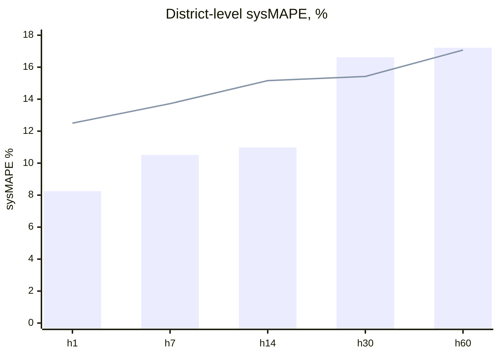

Blue bars = xgboost_wx, orange line = B0. xgboost_wx is better than B0 at district level up to h14; at h30–h60 the two are about level.

### 4.6 Network levels

WAPE is computed bottom-up from households, with bias in brackets.

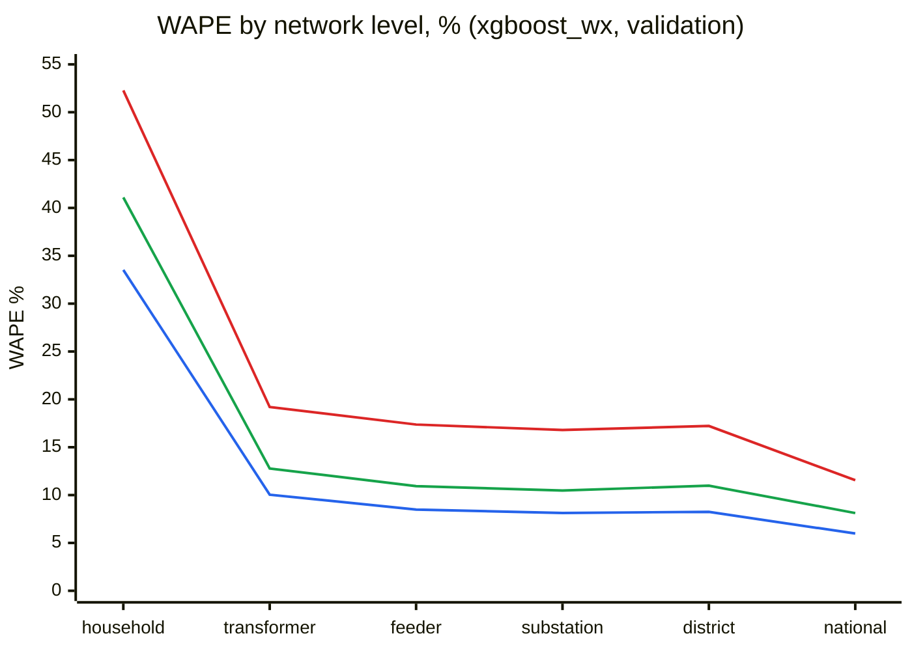

**Blue** = h1, **green** = h14, **red** = h60.

| WAPE (bias) | h1 | h7 | h14 | h30 | h60 |
|---|---|---|---|---|---|
| household | 33.52% (−1.5) | 37.83% (−1.7) | 41.10% (+0.6) | 46.18% (−3.4) | 52.28% (−5.1) |
| transformer | 10.04% (−1.3) | 12.17% (−1.1) | 12.78% (+1.1) | 18.16% (−2.9) | 19.20% (−3.5) |
| feeder | 8.49% (−1.5) | 10.53% (−1.7) | 10.93% (+0.7) | 16.40% (−3.5) | 17.37% (−5.0) |
| substation | 8.13% (−1.5) | 10.25% (−1.7) | 10.48% (+0.6) | 16.11% (−3.5) | 16.80% (−5.1) |
| district | 8.25% (−1.5) | 10.51% (−3.0) | 10.98% (−0.4) | 16.62% (−5.6) | 17.22% (−7.4) |
| national | 5.98% (−1.5) | 7.21% (−3.0) | 8.12% (−0.4) | 12.64% (−5.6) | 11.55% (−7.4) |

| MAE, kWh per node-day | h1 | h7 | h14 | h30 | h60 |
|---|---|---|---|---|---|
| household | 2.6 | 2.9 | 3.0 | 3.4 | 3.6 |
| transformer | 51.9 | 61.2 | 61.8 | 88.7 | 86.5 |
| feeder | 388 | 465 | 478 | 722 | 696 |
| substation | 1,364 | 1,642 | 1,709 | 2,641 | 2,448 |
| district | 28,978 | 36,969 | 37,753 | 57,193 | 55,923 |
| national | 105,080 | 126,855 | 139,490 | 217,569 | 187,468 |

Errors cancel out quickly once households are summed: 33.5 % at household level falls to about 10 % at transformer level and 8 % at substation level (h1).

---

## 5. Caveats and next steps

| Caveat | Effect |
|---|---|
| 24 scored dates (17 at h60) | Noisy: h30 / h60 can move by a point on one bad week |
| 5-district sample, supplementary split | A national run and the standard split are needed before conclusions |
| XGBoost early stopping is unstable | 73–1,132 trees between refits and runs; h30–h60 differ by up to 2.5 points between two runs with the same settings (§4.4) |
| Final tree cap (1,500 or 4,000) | Never binding for XGBoost; not the cause of the run-to-run differences |
| c(o) scaling not settled | Unscaled was better everywhere in the first run, mixed in the rerun |
| `housing_type_id` snapshot, `loyo` normals | Same possible leakage as the no-weather models |

- [x] `xgboost --issue-dates reforecast` on the same 24 dates (the clean weather effect, §4.4)
- [x] Retrain on `e9c5504` (GPU, up to 4,000 trees) and rerun both
- [ ] Stability fix: XGBoost learning rate 0.05, a minimum tree count, a 42-day early-stopping slice
- [ ] Per-horizon blend: `xgboost_wx` for h1–h7, B0 or the ensemble beyond
- [ ] Old-data ablation: `OLD_WEIGHT` 0.5 and `INCLUDE_OLD: non_winter`
- [ ] `catboost_wx` (shares the fit) and an ensemble with NLinear_x on the same dates
- [ ] Try `--weather fcn3` and `ens`
- [ ] Standard split (2024 validation, 48 forecast dates) and a national run

## Scripts used

| Step | Script |
|---|---|
| Entry point | [`evaluate.py`][evaluate] → [`harness/cli.py`][cli] (`--weather aifs`, `--issue-dates`) → [`harness/test_mode.py`][test-mode] |
| Model | [`models/xgboost_wx/model.py`][model], [`config.yaml`][cfg], [`NOTES.md`][notes] |
| Forecast archive | [`core/reforecast.py`][rf] ([`to_daily`][rf-daily], [`load_archive`][rf-load], [`to_window_convention`][rf-conv]) |
| Training windows | [`core/wx_windows.py`][wx] ([`fixed_origins`][wx-fixed], [`district_worker`][wx-worker]) |
| Fit and predict | [`core/boost_wx_harness.py`][bw] ([`train`][bw-train], [`Predictor`][bw-pred]) → [`core/whole_pipeline_v8.py`][v8] ([`build_features`][v8-feat], [`fit_and_evaluate`][v8-fit]) |
| Forecast at predict time | [`harness/weather.py`][weather] ([`reforecast_grid`][w-grid], [`grid_at_last_day`][w-last]) |
| Scoring, B0 | [`harness/testset.py`][testset] |
| Tests | [`tests/test_reforecast.py`][tests] |
| GPU check | [`scripts/gpu_check.py`][gpu] |

[c-run]: https://github.com/Avazbek2002/electricity/commit/32ce0827c0a287e5218b1891290993e98535a717
[evaluate]: https://github.com/Avazbek2002/electricity/blob/32ce0827c0a287e5218b1891290993e98535a717/evaluate.py
[cli]: https://github.com/Avazbek2002/electricity/blob/32ce0827c0a287e5218b1891290993e98535a717/harness/cli.py#L30
[test-mode]: https://github.com/Avazbek2002/electricity/blob/32ce0827c0a287e5218b1891290993e98535a717/harness/test_mode.py
[tm-blocks]: https://github.com/Avazbek2002/electricity/blob/32ce0827c0a287e5218b1891290993e98535a717/harness/test_mode.py#L294
[tm-subst]: https://github.com/Avazbek2002/electricity/blob/32ce0827c0a287e5218b1891290993e98535a717/harness/test_mode.py#L275
[levels]: https://github.com/Avazbek2002/electricity/blob/32ce0827c0a287e5218b1891290993e98535a717/harness/test_mode.py#L228
[network]: https://github.com/Avazbek2002/electricity/blob/32ce0827c0a287e5218b1891290993e98535a717/harness/test_mode.py#L248
[spec-s25]: https://github.com/Avazbek2002/electricity/blob/32ce0827c0a287e5218b1891290993e98535a717/configs/test_set_2025.yaml
[model]: https://github.com/Avazbek2002/electricity/blob/32ce0827c0a287e5218b1891290993e98535a717/models/xgboost_wx/model.py
[cfg]: https://github.com/Avazbek2002/electricity/blob/32ce0827c0a287e5218b1891290993e98535a717/models/xgboost_wx/config.yaml
[notes]: https://github.com/Avazbek2002/electricity/blob/32ce0827c0a287e5218b1891290993e98535a717/models/xgboost_wx/NOTES.md
[rf]: https://github.com/Avazbek2002/electricity/blob/32ce0827c0a287e5218b1891290993e98535a717/core/reforecast.py
[rf-wxconfig]: https://github.com/Avazbek2002/electricity/blob/32ce0827c0a287e5218b1891290993e98535a717/core/reforecast.py#L60
[rf-daily]: https://github.com/Avazbek2002/electricity/blob/32ce0827c0a287e5218b1891290993e98535a717/core/reforecast.py#L134
[rf-load]: https://github.com/Avazbek2002/electricity/blob/32ce0827c0a287e5218b1891290993e98535a717/core/reforecast.py#L236
[rf-conv]: https://github.com/Avazbek2002/electricity/blob/32ce0827c0a287e5218b1891290993e98535a717/core/reforecast.py#L259
[wx]: https://github.com/Avazbek2002/electricity/blob/32ce0827c0a287e5218b1891290993e98535a717/core/wx_windows.py
[wx-fixed]: https://github.com/Avazbek2002/electricity/blob/32ce0827c0a287e5218b1891290993e98535a717/core/wx_windows.py#L24
[wx-grid]: https://github.com/Avazbek2002/electricity/blob/32ce0827c0a287e5218b1891290993e98535a717/core/wx_windows.py#L43
[wx-worker]: https://github.com/Avazbek2002/electricity/blob/32ce0827c0a287e5218b1891290993e98535a717/core/wx_windows.py#L58
[bw]: https://github.com/Avazbek2002/electricity/blob/32ce0827c0a287e5218b1891290993e98535a717/core/boost_wx_harness.py
[bw-fs]: https://github.com/Avazbek2002/electricity/blob/32ce0827c0a287e5218b1891290993e98535a717/core/boost_wx_harness.py#L49
[bw-train]: https://github.com/Avazbek2002/electricity/blob/32ce0827c0a287e5218b1891290993e98535a717/core/boost_wx_harness.py#L75
[bw-pred]: https://github.com/Avazbek2002/electricity/blob/32ce0827c0a287e5218b1891290993e98535a717/core/boost_wx_harness.py#L163
[v8]: https://github.com/Avazbek2002/electricity/blob/32ce0827c0a287e5218b1891290993e98535a717/core/whole_pipeline_v8.py
[v8-blend]: https://github.com/Avazbek2002/electricity/blob/32ce0827c0a287e5218b1891290993e98535a717/core/whole_pipeline_v8.py#L1392
[v8-ddmm]: https://github.com/Avazbek2002/electricity/blob/32ce0827c0a287e5218b1891290993e98535a717/core/whole_pipeline_v8.py#L1302
[v8-feat]: https://github.com/Avazbek2002/electricity/blob/32ce0827c0a287e5218b1891290993e98535a717/core/whole_pipeline_v8.py#L1928
[v8-anom]: https://github.com/Avazbek2002/electricity/blob/32ce0827c0a287e5218b1891290993e98535a717/core/whole_pipeline_v8.py#L2064
[v8-mm]: https://github.com/Avazbek2002/electricity/blob/32ce0827c0a287e5218b1891290993e98535a717/core/whole_pipeline_v8.py#L2071
[v8-fit]: https://github.com/Avazbek2002/electricity/blob/32ce0827c0a287e5218b1891290993e98535a717/core/whole_pipeline_v8.py#L2327
[weather]: https://github.com/Avazbek2002/electricity/blob/32ce0827c0a287e5218b1891290993e98535a717/harness/weather.py
[w-grid]: https://github.com/Avazbek2002/electricity/blob/32ce0827c0a287e5218b1891290993e98535a717/harness/weather.py#L65
[w-last]: https://github.com/Avazbek2002/electricity/blob/32ce0827c0a287e5218b1891290993e98535a717/harness/weather.py#L76
[testset]: https://github.com/Avazbek2002/electricity/blob/32ce0827c0a287e5218b1891290993e98535a717/harness/testset.py
[b0]: https://github.com/Avazbek2002/electricity/blob/32ce0827c0a287e5218b1891290993e98535a717/harness/testset.py#L192
[common-panel]: https://github.com/Avazbek2002/electricity/blob/32ce0827c0a287e5218b1891290993e98535a717/harness/testset.py#L276
[sm]: https://github.com/Avazbek2002/electricity/blob/32ce0827c0a287e5218b1891290993e98535a717/harness/testset.py#L312
[bias]: https://github.com/Avazbek2002/electricity/blob/32ce0827c0a287e5218b1891290993e98535a717/harness/testset.py#L320
[score]: https://github.com/Avazbek2002/electricity/blob/32ce0827c0a287e5218b1891290993e98535a717/harness/testset.py#L324
[plots]: https://github.com/Avazbek2002/electricity/blob/32ce0827c0a287e5218b1891290993e98535a717/harness/plots.py#L69
[tests]: https://github.com/Avazbek2002/electricity/blob/32ce0827c0a287e5218b1891290993e98535a717/tests/test_reforecast.py
[gpu]: https://github.com/Avazbek2002/electricity/blob/32ce0827c0a287e5218b1891290993e98535a717/scripts/gpu_check.py
